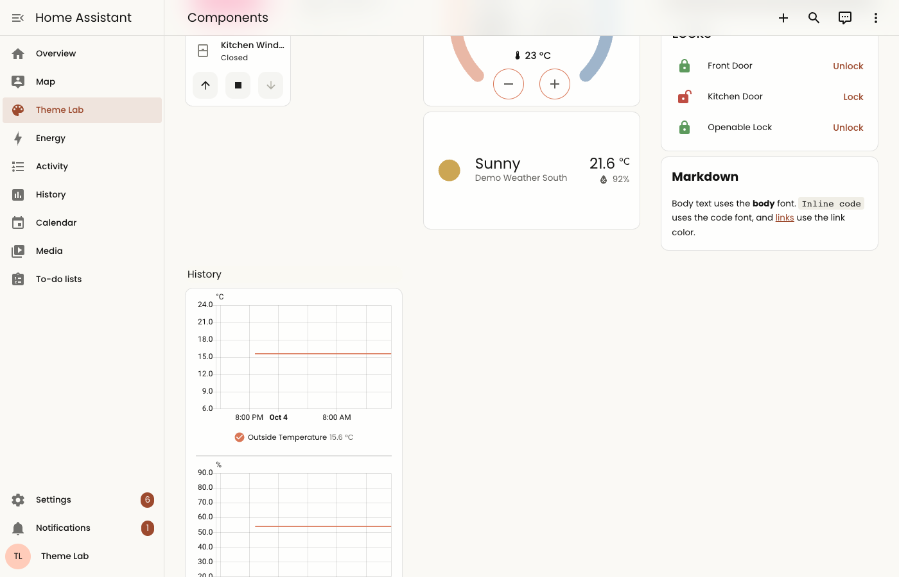
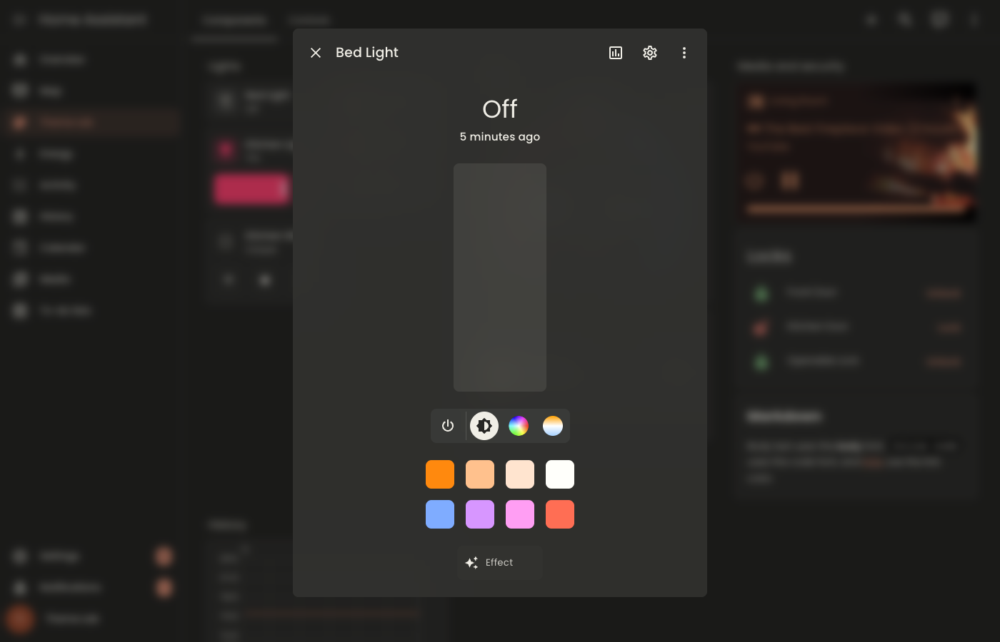
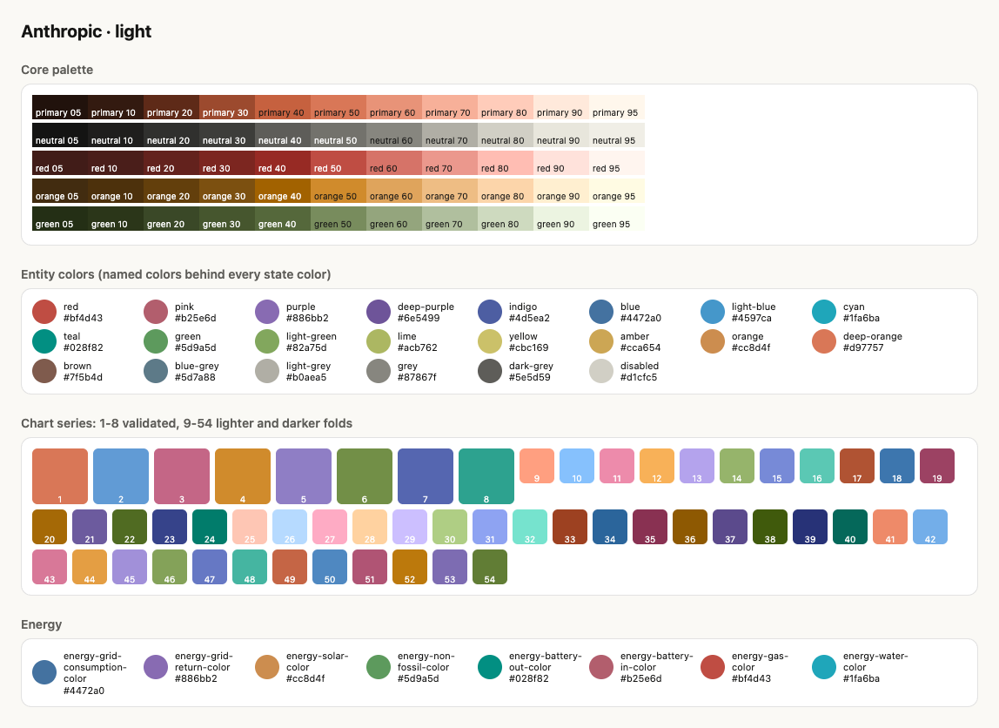
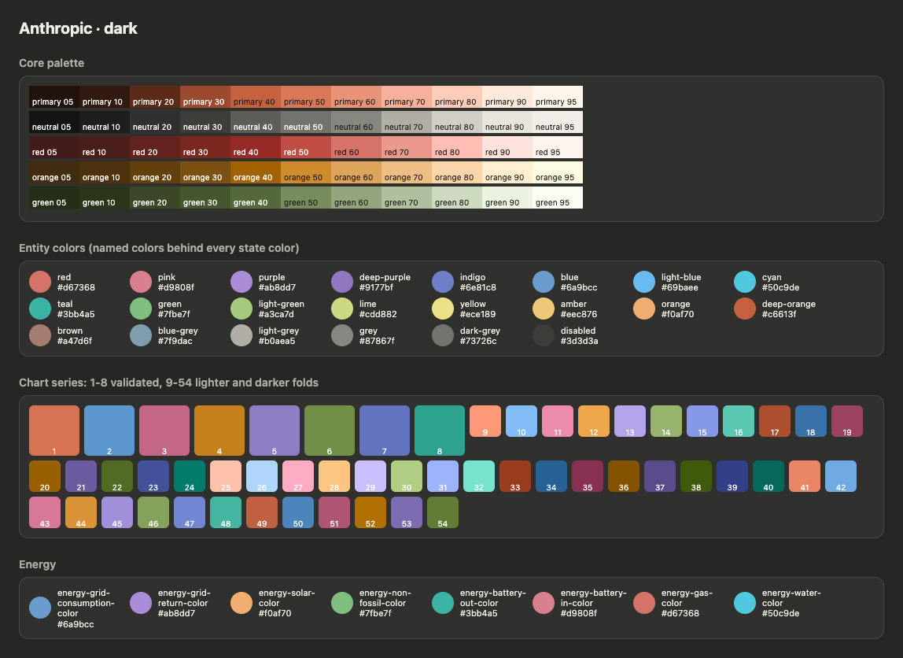

# HA Themes

[](https://github.com/roquerodrigo/ha-themes/actions/workflows/ci.yml)
[](https://github.com/hacs/integration)

[](https://my.home-assistant.io/redirect/hacs_repository/?owner=roquerodrigo&repository=ha-themes&category=integration)

---

Themes for the current Home Assistant frontend, built from its real design tokens.

The frontend's theming surface changed substantially in 2025–2026 (a core palette with
semantic color layers, Web Awesome components, foundation tokens for spacing, radii and
motion), and most theme documentation describes the older variable set. This project
captures the tokens the running frontend actually declares and reads, documents them, builds
themes from a small validated definition, and ships them as an integration that installs
the themes and the support module they need.

| Light | Dark |
| --- | --- |
|  |  |

## Themes

| Theme | Description |
| --- | --- |
| Anthropic | Warm paper neutrals, clay primary, brand blue and green accents; Poppins |
| Anthropic System UI | The same theme in the platform's UI font |

Every theme has light and dark modes and follows the
[house conventions](docs/creating-a-theme.md#house-conventions): sidebar and header in the
page background, no shadows, backdrop blur on the header, cards and dialogs, a harmonized
entity palette, chart series validated for color-vision deficiencies, generic integration
icons in the primary color, and a system-ui variant.

| Palette, light | Palette, dark |
| --- | --- |
|  |  |

## Installation

1. Make sure `configuration.yaml` loads themes from the `themes` directory (most
   installations that use HACS themes already do):

   ```yaml
   frontend:
     themes: !include_dir_merge_named themes
   ```

2. In HACS, add this repository as a custom repository of type **Integration** (or use
   the button above), download **HA Themes** and restart Home Assistant.
3. Go to **Settings → Devices & services → Add integration → HA Themes** and confirm.
4. Pick a theme in your profile.

The integration:

- installs the themes into `themes/ha_themes/` and reloads them — updates arrive with every
  HACS update, and deleting the integration entry removes the files ([Removal](#removal)). The integration owns that
  directory: any other file placed there is deleted (and logged) on the next install or
  reload, so keep your own themes elsewhere under `themes/`. Do not reuse the names of the
  shipped themes either — Home Assistant keeps only one theme per name, and which file wins
  depends on the order it reads them;
- loads a support module on every page, which applies the theme font to the whole UI
  (Home Assistant hard-codes Roboto on the page body), loads the web fonts of the active
  theme, gives dropdown menus the theme's surface color, outlines toasts when shadows are
  flat, keeps the energy totals card one tone and recolors the generic integration icons. It stays dormant, observing nothing,
  until a project theme is applied globally or to a view or card, and falls dormant again
  when none is left, so users on other themes are not affected. It is served under a
  content-hash URL, so browser and service worker caches never keep an outdated copy;
- requests fonts from Google Fonts (`fonts.googleapis.com`, `fonts.gstatic.com`) only while
  a theme that declares them is active — globally, or on a view or card. The System UI
  variants, the default theme and other themes make no font request;
- raises a repair issue if the themes directory is not included in `configuration.yaml`, or
  with the error if Home Assistant refuses to reload the themes, and re-checks it on every
  theme reload, so fixing the configuration and reloading the themes clears it.

## Removal

Remove the integration in this order, so it can delete the files it installed:

1. Go to **Settings → Devices & services → HA Themes** and delete the integration entry. This
   deletes `themes/ha_themes/` and reloads the themes.
2. Remove **HA Themes** in HACS and restart Home Assistant.

If HA Themes was removed in HACS first, Home Assistant can no longer run its cleanup: the themes
stay selectable but load without the support module (no web fonts, Roboto on the page body,
dropdown menus in the page color, toasts without an edge, a page-toned table inside the
energy totals card, integration icons in their default colors). To clean up manually, delete
the leftover entry under **Settings → Devices & services**, delete the `themes/ha_themes/`
directory and call the `frontend.reload_themes` action (or restart Home Assistant).

## Documentation

| Path | What it is |
| --- | --- |
| [`docs/theming-guide.md`](docs/theming-guide.md) | How themes are applied today: token layers, modes, derived values, entity and chart colors, fonts, icons, known upstream issues |
| [`docs/creating-a-theme.md`](docs/creating-a-theme.md) | Theme definition schema, roles, palettes and validation |
| [`docs/tokens-global.md`](docs/tokens-global.md) | Every globally declared token with light and dark defaults (generated) |
| [`docs/tokens-components.md`](docs/tokens-components.md) | Component hooks and dynamic token families (generated) |
| [`catalog/tokens.json`](catalog/tokens.json) | Machine-readable catalog the builder validates against |

## Development

Requires Python 3.14, [uv](https://docs.astral.sh/uv/) and Google Chrome.

| Path | What it is |
| --- | --- |
| [`custom_components/ha_themes/`](custom_components/ha_themes) | The integration; `themes/` and `frontend/` inside it are generated |
| [`themes-src/`](themes-src) | Theme definitions |
| [`toolkit/`](toolkit) | Token capture, documentation and theme builder (not shipped) |
| [`dev/`](dev) | Local Home Assistant configuration with demo entities and the Theme Lab dashboard |
| [`previews/`](previews) | Palette sheets and screenshots of every theme in both modes |

```bash
scripts/setup                      # install the development environment
scripts/dev-server                 # local Home Assistant on :8123 running the integration
scripts/ha-themes onboard          # first run only: test user + the integration
```

| Command | Purpose |
| --- | --- |
| `scripts/ha-themes build [slug…] [--strict]` | Build `themes-src/` into the integration and validate |
| `scripts/ha-themes preview [slug…] [--palette-only]` | Render palette sheets and screenshot themes in Google Chrome |
| `scripts/ha-themes palette [slug…]` | Rank chart series orders that pass the checks, and list entity colors |
| `scripts/ha-themes catalog` | Re-capture the token catalog from the dev instance and regenerate the reference docs |
| `scripts/ha-themes docs` | Regenerate the reference docs from `catalog/tokens.json` |
| `scripts/lint` | Format check, lint, type check and tests, as CI runs them |

The dev server mirrors `custom_components/ha_themes` into the dev configuration on every
start; after `ha-themes build`, restart it (or reload the integration) to see a change.

### Updating to a new Home Assistant release

1. Bump `homeassistant`, `home-assistant-frontend` and the matching
   `pytest-homeassistant-custom-component` in `pyproject.toml`, and `homeassistant` in
   `hacs.json`; run `uv sync`. Dependabot ignores these three packages, and pytest,
   pytest-asyncio and pytest-cov are not pinned here because the test harness pins them.
   Until the catalog is re-captured, `toolkit/tests/test_pinned_versions.py` fails.
2. Restart `scripts/dev-server` and run `scripts/ha-themes catalog`.
3. Review the diff of `catalog/tokens.json` and the generated docs: new, removed and changed
   tokens, and the broken-reference list.
4. Run `scripts/ha-themes build --strict` — unknown tokens point at themes that need updating.
5. Review what is kept by hand against the frontend: `UPSTREAM_FIXES` in
   `toolkit/ha_theme_kit/theme/roles.py` (drop fixes the frontend no longer needs),
   `FRONTEND_SERIES` in `chart_palette.py` and `FRONTEND_NAMED_HUES` in `entity_palette.py`,
   and the version header and known-issues table of `docs/theming-guide.md`. Run
   `scripts/lint`: tests fail while these disagree with the new catalog.
6. Regenerate previews and compare.

### How the catalog is captured

- **Runtime (Google Chrome):** the installed Chrome is driven through Playwright with an
  isolated profile. In light and dark mode it reads every custom property declared on
  `html` in the document and adopted stylesheets, the inline values the theme engine sets,
  and their computed values.
- **Bundle scan:** every chunk of the installed frontend package is scanned for
  `var(--token, fallback)` references, script reads and dynamically built names, which
  yields how widely each token is used and the component hooks that are never declared
  globally.

## Brand assets

`custom_components/ha_themes/brand/` holds the icon Home Assistant shows for the integration:
the Lucide `palette` glyph as a glass app icon, generated with
[Glass Icons](https://www.rodrigoroque.dev/glass-icons/?icon=lucide%2Fpalette&bg1=22d3ee&bg2=0e7490&color=ffffff&tint=ffffff&size=0.65&glass=0&shadow=0.5&blur=32&shape=rounded&optical=1). `icon.svg` is the exported source; `icon.png` and `icon@2x.png` are
square renders of it, and `logo.png` / `dark_logo.png` (with `@2x` variants) put the icon
beside the "HA Themes" wordmark for light and dark backgrounds. Render the PNGs from
`icon.svg` in Google Chrome on a transparent background at the sizes
`tests/test_brand.py` checks.
